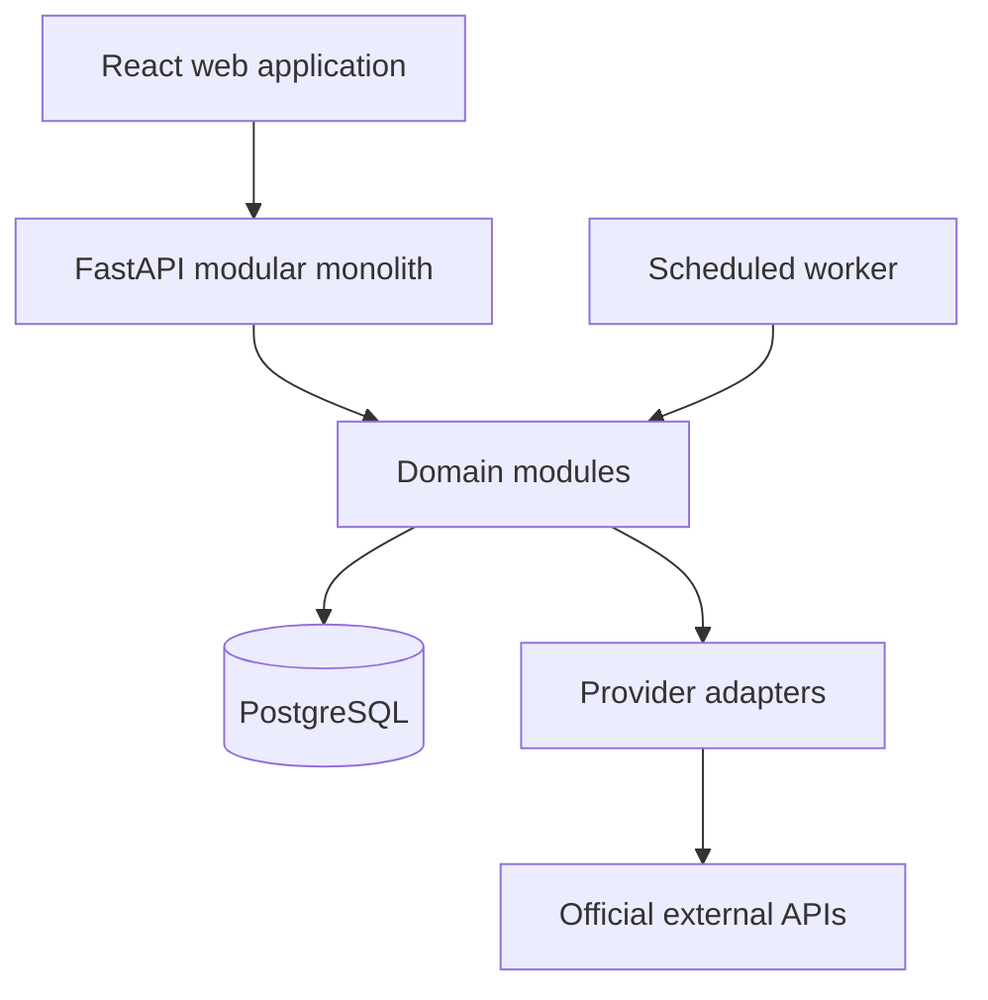

# CommandOS Architecture

**Status:** Accepted for Feature 001

## Shape

CommandOS uses a modular monolith: one React frontend, one FastAPI backend, one PostgreSQL database, and one separate worker process using the backend package.

## Components

- Frontend: React, TypeScript, Tailwind, TanStack Query, Recharts.
- Backend: FastAPI, Pydantic, SQLAlchemy, Alembic, HTTPX, Authlib.
- Modules: identity, business context, providers, analytics, creator intelligence, AI strategy, content studio, and audit.
- Worker: PostgreSQL-backed sync runs, database locking, bounded retries, checkpoints, and cancellation.
- Database: validated relational facts; JSON only for justified traceability and forward compatibility.

Redis, Celery, LangGraph, pgvector, event streaming, and microservices are deferred until a demonstrated requirement exists.

## Provider boundary

Adapters implement declared capabilities:

- `ConnectionProvider`: authorize, refresh, revoke, health.
- `OwnAnalyticsProvider`: accounts, content, metrics.
- `PublicResearchProvider`: permitted public observations.
- `ProviderCapabilityRegistry`: metrics, scopes, date limits, retention, freshness, and rate limits.

Domain services consume validated internal models, never provider-specific dictionaries.

## Synchronization

1. Authorize owner and workspace.
2. Validate connection and capability.
3. Create a sync run with an idempotency key.
4. Load the last successful checkpoint.
5. Retrieve bounded pages/report windows.
6. Validate responses.
7. Upsert bounded transactional batches.
8. Record unavailable or restricted metrics explicitly.
9. Advance checkpoints only after commit.
10. Complete the run with counts, freshness, quota observations, and redacted errors.

## Security boundaries

- Browser to API: secure owner session and CSRF protection where applicable.
- API to provider: backend OAuth with read-only scopes.
- Application to database: least-privilege credentials and encrypted transport.
- Worker: credentials resolved only for the active job.
- AI: allowlisted tools, schemas, and repeated authorization.

OAuth tokens and application secrets never enter Git, logs, fixtures, screenshots, or AI prompts.

## Reliability and testing

- Database idempotency, typed provider errors, structured logs, correlation IDs, and sync metrics.
- Unit tests for transformation, metric states, retries, and authorization.
- Sanitized contract fixtures.
- PostgreSQL integration tests.
- OAuth/revocation security tests.
- End-to-end tests for login, connection, sync, freshness, and disconnect.
- Live-provider tests are opt-in and excluded from ordinary CI.

Deployment remains a separate human-authorized action.
